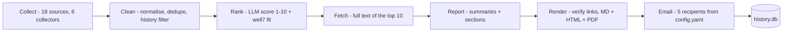

# Weekly Synthetic Data Research Agent


[](../../tree/web)

Collects seven days of synthetic-data content from 18 sources across 6 collectors —
arXiv, Google News, research blogs, Reddit, Hacker News and GitHub (27 HTTP requests
per run) — then renders a weekly report for the Well7 team.

**Two versions live in this repo:**

- **`main` (this branch)** — the Python agent: collectors → LangGraph pipeline →
  Markdown/HTML/PDF report → email. The source of truth.
- **[`web` branch](../../tree/web)** — a Cloudflare Workers + D1 + React archive/view
  of the same weekly report, with its own JS pipeline inside the Worker.

**The collection half is automated. Ranking, summarising and sending are not.**
`main.py` collects, dedupes, filters against history and prints/saves raw items.
Everything after that is a script you run by hand, with a human writing
`source.yaml`. This README is honest about where that line is.

- Design notes and gotchas for coding agents: [`AGENTS.md`](AGENTS.md)
- Why each source is on the list: [`docs/sources.md`](docs/sources.md)
- What works, what does not, what is next: [`docs/one-page-note.md`](docs/one-page-note.md)
- Everything produced so far: [`progress/README.md`](progress/README.md)

## Sample output

From [`progress/week-2026-11-06/report.md`](progress/week-2026-11-06/report.md)
(subject `Synthetic Data Weekly — Week of 31 Oct – 6 Nov 2026`, emailed as HTML
with the PDF attached):

> **1. [nathanielkang/CrossSynth](https://github.com/nathanielkang/CrossSynth)**
> *GitHub · 31 Oct 2026*
> When sites train generators on uneven shards, the synthetic union can keep the
> counts and still miss the joints. CrossSynth is a federated tabular
> synthesizer. Each party trains a local diffusion model under differential
> privacy.
>
> **2. [Sejal116/federated-hospitals-simulation](https://github.com/Sejal116/federated-hospitals-simulation)**
> *GitHub · 4 Nov 2026*
> A small experiment on how hospitals can train a shared medical AI model
> without sharing patient data — comparing single-hospital, pooled and
> federated training, then testing what privacy noise costs in accuracy and
> whether membership inference can tell who was in the training data.
>
> **3. [opendp/opendp](https://github.com/opendp/opendp) (447★)**
> *GitHub · 4 Nov 2026*
> The OpenDP Library is a modular collection of statistical algorithms that
> adhere to the definition of differential privacy, implemented in Rust with
> Python and R bindings.

Every link in that report was verified HTTP 200 before being included; dates are
checked against the week window by `verify_report.py`.

## Pipeline

One shared `AgentState` moves through seven LangGraph nodes; the LLM is used only
where judgment is needed (ranking and writing), everything else is plain Python.
Nodes record errors into the state instead of raising, so one bad source never
stops the report.



The key locks are: nothing renders unless a link passes the HTTP check, a dry run
or failed send never marks a URL as published, and `history.db` (the only memory)
means no link ever appears twice.

## Requirements

- Python 3.11+ (the project's venv uses 3.13)
- [uv](https://docs.astral.sh/uv/) (recommended) or plain pip
- Windows PowerShell 5.1 is what this was built on; nothing is Windows-specific
  except the notes below about `python` not being on `PATH`.

## Setup

```powershell
uv sync                          # runtime + dev dependencies into .venv
```

Or, for a machine that only runs the job:

```powershell
pip install -r requirements.txt  # runtime only, no notebooks or SDV
```

`requirements.txt` is generated from `uv.lock`. Nothing enforces that, so regenerate
it after any dependency change:

```powershell
uv export --no-hashes --no-dev -o requirements.txt
```

## Run it

Every command below assumes the venv is active. On the original machine `python` is
not on `PATH`, so the working forms are `uv run python …` or
`.venv\Scripts\python.exe …`.

```powershell
uv run python main.py                    # every source → raw_items.json + raw_run_log.json
uv run python main.py --source arxiv --limit 5 --no-save    # one source, nothing written
```

`--source` takes *collector* names — `arxiv`, `news`, `blog`, `reddit`, `hn`,
`github` — not the `config.yaml` keys (`google_news`, `blogs`, `hacker_news` would
match nothing and exit 1).

`main.py` prints every item by default, which is the Phase 1 deliverable: "a script
that prints all raw items found this week". `--limit N` caps the print, and `--all`
is the same as `--limit 0`. Items already in `history.db` are not printed — the
summary counts them as `already sent (history)`.

The weekly pipeline, in order:

```powershell
uv run python main.py --pipeline        # collect → clean → rank → fetch → report → render → send
uv run python main.py --pipeline --dry-run   # same, but write email.eml instead of sending
uv run python verify_report.py          # check the rendered artefacts
```

The individual steps are still runnable by hand:

```powershell
uv run python main.py
uv run python rank_items.py              # LLM scores 1-10 → ranked.json
uv run python fetch_candidates.py        # top 10 from ranked.json → candidates.json
uv run python write_report.py            # summaries + sections → source.yaml
uv run python report_build.py progress/week-2026-11-05/source.yaml
uv run python send_report.py progress/week-2026-11-05/source.yaml --dry-run
uv run python verify_report.py
```

| Script | What it does | Writes |
|---|---|---|
| `main.py` | Collects, normalises, dedupes, drops already-published URLs; `--pipeline` runs the whole graph | `raw_items.json`, `raw_run_log.json`, report + email |
| `rank_items.py` | Scores each item 1–10 for relevance and 1–10 for Well7 fit, with a reason; collapses same-story coverage | `ranked.json`, `score_cache.json`, merges into `raw_run_log.json` |
| `fetch_candidates.py` | Takes the top 10 from `ranked.json`, resolves redirects, extracts full article text | `candidates.json` |
| `write_report.py` | Writes summaries from the fetched text and splits the three sections | `source.yaml` |
| `report_build.py` | Verifies every link, drops dead ones, renders, records published URLs when run standalone | `report.md`, `report.html`, PDF, `run_log.json`, appends to `history.db` |
| `send_report.py` | Emails the rendered report as the body plus a PDF attachment; `--dry-run` writes `email.eml` | `email.eml`, updates `run_log.json`, appends to `history.db` after a real send |
| `schedule_task.py` | Registers/query/deletes the Saturday Windows task from `config.yaml`; dry-run by default, `--send` for real email | Windows Task Scheduler |
| `verify_report.py` | Checks the rendered report against the brief | exit code only |
| `selftest.py` | Offline unit tests for parsing, dates, dedupe, history, ranking, email, scheduling | exit code only |
| `feed_health.py` | Checks all 13 blog feeds are alive | stdout |
| `validate_phase1.py` | Validates window and dedupe in an existing `raw_items.json` | stdout + exit code |

`rank_items.py` needs `OPENROUTER_API_KEY` in `.env`. A rerun costs nothing: scores
are cached by URL + model + rubric version in `score_cache.json`, and a cached rerun
produces a byte-identical `ranked.json`.

## Configuration

Everything tunable lives in `config.yaml`, never in the collectors.

| Key | Meaning |
|---|---|
| `schedule` | Weekly cadence read by `schedule_task.py` (`Saturday 08:00`). |
| `lookback_days` | How far back an item may be published. Default 7. Read by every collector. |
| `max_top_picks` | Shortlist size. Read by `fetch_candidates.py` and `rank_items.py`. |
| `ranking.*` | Model, batch size, concurrency, thresholds and cache toggle for Phase 2. |
| `summarising.*` | Model, picks, tool/worth caps, text window and token budget for Phase 3. |
| `recipients` | Who the report goes to. Read by `emailer.deliver`. |
| `keywords` | The Phase 0 vocabulary, for reference. Collectors search each source's own `queries` / `tags` / `subreddits`. |
| `sources.*` | Per-source queries, subreddits, feeds and result caps. |

Secrets do not live in `config.yaml`. Copy `.env.example` to `.env` and fill it in.
`.env` is git-ignored and holds `OPENROUTER_API_KEY` plus the SMTP credential set.
The SMTP keys are still empty placeholders, which is why no real email has been sent.

## Outputs

```
raw_items.json                     every surviving item this run
raw_run_log.json                   found / duplicates / already_sent / kept / errors,
                                   plus a merged `ranking` block
ranked.json                        every item with score, well7_fit, reason, status
score_cache.json                   scores keyed by URL + model + rubric version
candidates.json                    full text of the shortlist
history.db                         URLs already published, so no link repeats
progress/week-<week_end>/
  source.yaml                      report content (trend, picks, tools, worth a look)
  report.md                        plain-text email body / Markdown deliverable
  report.html                      HTML email body, spec format
  Synthetic_Data_Weekly_<date>.pdf glossary first, then the report (email attachment)
  email.eml                        dry-run email; never sent, for inspection
  run_log.json                     counts for the render, plus the `email` block
```

`history.db` is how "no link in two different weeks" is enforced. `collect_all`
filters against it before ranking. A standalone `report_build.py` records the URLs
it rendered. In the pipeline, `render` passes `--no-record` and the `send` node
records the URLs only after SMTP succeeds — so a dry run or a failed send never
suppresses next week's copy of the same link. Delete `history.db` to replay a week
from scratch.

## What it does not do yet

- **No real email has been sent.** The send path is implemented and dry-run tested,
  but `.env` still has empty SMTP placeholders. `send_report.py` fails loudly without
  them, and `main.py --pipeline` records `send: EmailError: SMTP_HOST is not set ...`.
- **The scheduled task runs dry.** The registered `SyntheticDataWeekly` task calls
  `scripts/run_weekly.ps1`, which adds `--dry-run` unless it is invoked with `-Send`.
  Each Saturday therefore writes a report and `email.eml` and never contacts SMTP.
  Re-register with `uv run python schedule_task.py --register --send` once a test
  email has arrived.
- **The scheduled task is interactive-only.** It runs as the current user when
  signed in, with no stored password, so it will not fire while the machine is
  signed out. `logs/weekly.log` is the evidence trail.
- **The ranker cannot judge substance.** It rewards any text that matches the
  rubric's vocabulary, so a zero-star repo can outrank a real paper. See
  `docs/one-page-note.md` for the comparison against the manual report.

## Gotchas

- **Hacker News returns HTTP 419** to non-browser clients. That is not a dead link —
  `links._check_hacker_news` verifies through the Algolia API on purpose.
- **Google News RSS links are opaque redirects.** They return 200 for anyone, so a
  status check proves nothing; `links.resolve_google_news` unwraps them through
  Google's `batchexecute` RPC.
- **Reddit rate-limits to about one request per minute per IP.** The collector backs
  off 15/30/45 s. A second full run inside a minute stalls ~90 s — that is backoff,
  not a hang.
- **arXiv announces nothing Friday or Saturday.** Most weeks end with a date gap.
- **`report_build.py` exits 1 when it dropped dead links.** That is a successful
  render of a filtered report, not a crash.

## Tests

There is no pytest, linter or CI. The suite is two scripts that exit non-zero on
failure:

```powershell
uv run python selftest.py       # offline: parsing, dates, URL normalisation, dedupe, history, email, schedule
uv run python verify_report.py  # structural: subject, section order, counts, dates, PDF
```
