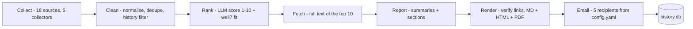

# Weekly Synthetic Data Research Agent


[](../../tree/web)

Collects seven days of synthetic-data content from 18 sources across 6 collectors —
arXiv, Google News, research blogs, Reddit, Hacker News and GitHub (3 arXiv queries,
2 Google News queries, 13 blog feeds, 1 combined Reddit feed, 4 Hacker News tags and
6 GitHub queries, plus bounded release lookups) — then renders a weekly report for
the Well7 team.

**Two versions live in this repo:**

- **`main`** — the Python agent: collectors → LangGraph pipeline →
  Markdown/HTML/PDF report → email + Cloudflare archive publish (`publish_to_cloudflare.py`). The single weekly producer.
- **[`web` branch](../../tree/web)** — a Cloudflare Workers + D1 + R2 + React live archive and
  Research Studio ([synthetic-data-web.coolbadrtv1.workers.dev](https://synthetic-data-web.coolbadrtv1.workers.dev)),
  synced directly from `main`'s verified weekly output via `POST /api/reports/publish`.

**Status:** Phases 0–5 are done and Phase 6 live delivery is underway (**1 of 2 Saturdays sent**): SMTP is configured, a real `send_report.py --test`
send landed in Primary Inbox (matching `From == SMTP_USER`, no PDF attachment, direct
publisher links), GitHub Actions (`.github/workflows/weekly-report.yml`) is set up
as the sole live Saturday scheduler (`05:17 UTC` / `08:17 UTC+3` / `13:17 UTC+8`, with
`LLM_API_KEY` and `SMTP_*` secrets configured; the local Windows task `SyntheticDataWeekly`
was removed so only one scheduler sends), and live catch-up run [`44910594323`](https://github.com/badrbajamil1-collab/synthetic-data-weekly/actions/runs/44910594323) (`2026-11-21`)
emailed all 5 Well7 recipients and published `week-2026-11-20` + PDF to Cloudflare D1/R2.
What remains is letting next Saturday (`2026-11-28`) run unattended, gathering recipient
feedback, and moving long-term production sending to an authenticated company-domain email
service. [Build plan and status](#build-plan-and-status) is the
honest scoreboard. Running `main.py` with no flags still performs the Phase 1
"print every raw item" deliverable; `--pipeline` is the one command for the whole
agent.

- Design notes and gotchas for coding agents: [`AGENTS.md`](AGENTS.md)
- Why each source is on the list: [`docs/sources.md`](docs/sources.md)
- What works, what does not, what is next: [`docs/one-page-note.md`](docs/one-page-note.md)
- Everything produced so far: [`progress/README.md`](progress/README.md)

## Build plan and status

The brief builds the agent in seven phases (0–6) and calls week 4 "the pilot".
This is where each phase stood on 2026-11-21.

| Phase | Brief deliverable | Status | Evidence |
|---|---|---|---|
| **0 — Understand the topic** | Manual report, 15–20 sources, 10–15 keywords | ✅ Done, two recorded blemishes | `progress/phase-0-manual/`, `docs/sources.md` (18 sources), `config.yaml` → `keywords` (22 terms) |
| **1 — Collectors** | A script that prints every raw item this week | ✅ Done | `python main.py`; 6 collectors over 18 sources, one fixed Saturday-Friday week (`src/synthetic_data/week.py`); `progress/week-2026-11-01/run_log.json` (223 found, 222 kept, 0 source errors) |
| **2 — Clean, filter and rank** | A ranked list comparable to the manual report | ✅ Done, tuned three times | `rank_items.py` → `ranked.json`; keyword prefilter, one comparative editor pass, structured JSON output; URL normalisation, primary-source dedupe and `history.db` |
| **3 — Summarise and write** | Markdown/HTML report in the brief's format | ✅ Done | `progress/week-*/report.md`, `.html`, PDF; `verify_report.py` (structural checks plus the 2026-11-11 schema gates) |
| **4 — LangGraph agent** | One command runs the whole pipeline | ✅ Done | `uv run python main.py --pipeline`; `src/synthetic_data/graph.py`; errors are recorded, not raised |
| **5 — Email and schedule** | You receive a correct test email | ✅ Email verified; scheduler active | `send_report.py --test` delivered to Primary Inbox (`From == SMTP_USER`, no PDF attachment); GitHub Actions scheduled live for Saturday `05:17 UTC` with `SMTP_*` secrets configured (local Windows task deleted to prevent duplicates) |
| **6 — Pilot and improve** | Two real Saturdays, recipient feedback, tuning | ⏳ In progress (1 / 2) | Live Saturday #1 delivered via catch-up run `44910594323` on 2026-11-21 (5/5 recipients emailed + Cloudflare D1/R2 published; missed the old `:00` cron before moving to `:17`). Next scheduled unattended run is 2026-11-28, then gather team feedback and tune |

**Where that leaves the project:** 1 of 2 Phase 6 live Saturdays delivered; awaiting the 2026-11-28 unattended run and team feedback.

**The brief's "done" test** is that the agent runs unattended for two Saturdays and
the team finds the reports useful. **GitHub Actions** (`.github/workflows/weekly-report.yml`)
is active with `LLM_API_KEY` and `SMTP_*` secrets for Saturday `05:17 UTC` (`08:17 UTC+3` /
`13:17 UTC+8`), and the local Windows task (`SyntheticDataWeekly`)
was removed so delivery does not duplicate or depend on the laptop staying awake. Live
catch-up run `44910594323` delivered Saturday #1 on `2026-11-21`; next scheduled unattended
live run is `2026-11-28`.

What is still next, in order:

1. Let Saturday #2 (`2026-11-28`) run unattended, check the GitHub Actions workflow run logs (`mode: send`) and uploaded artefacts, and collect the
   recipients' feedback across both weeks. Do not tune from a single week.
2. Then tune keywords, sources and prompts (Phase 6).
3. If consumer SMTP starts hitting spam on multi-recipient sends, move delivery
   to a dedicated sending service on the company domain (SPF/DKIM/DMARC).

The two Phase 0 blemishes are recorded in `docs/one-page-note.md`: six top picks
instead of the brief's example seven, and no record of which 3–5 introductions were
read.

## Sample output

Excerpt from [`progress/week-2026-11-05/report.md`](progress/week-2026-11-05/report.md)
(subject `Synthetic Data Weekly — Week of 30 Oct – 5 Nov 2026`, automated dry-run excerpt;
PDF attachment is off by default for deliverability unless `--attach-pdf` is passed). Both picks are arXiv papers, and both summaries are model-written
and passed the number/length guard — not extractive fallbacks.

> **1. [CoRTeC: A Differentially Private Release for Synthetic Tabular Data, Decodable by Any Generator](https://arxiv.org/abs/2611.06342)**
> *arXiv · 4 Nov 2026*
> CoRTeC releases differentially private synthetic tabular data by spending a privacy
> budget once on a file of noisy counts — group sizes, outcome balances, column
> histograms per outcome, and outcome rates in cells — that anyone can decode into
> synthetic rows at no privacy cost using a maximum-entropy decoder or language models
> that never see real records. At ε=2 on Adult the release trains classifiers within
> 0.02 AUC of a real sample; on NHANES and bank marketing it stays within 0.05 AUC
> without the selection step. Controls show utility comes from the release and
> selection step, no private row reaches a model, no generated row copies a real one,
> and the strongest membership attack remains far below the budget bound.
>
> **3. [Exploring the Privacy--Size Tradeoff for Differentially Private Self-Attentive Variational Autoencoders](https://arxiv.org/abs/2611.05582)**
> *arXiv · 3 Nov 2026*
> SAVANT, a self-attentive variational autoencoder for tabular data trained with
> DP-SGD, combines attention, VAE, and differential privacy in one model. Evaluated
> against PrivBayes and MST on two public datasets across privacy budgets and dataset
> sizes, it shows that more data generally increases utility under the same DP
> guarantee. Marginal mechanisms absorb most utility loss from strict budgets, while
> DP-SGD exchanges data for budget at a worse rate; membership-inference attacks
> detected no aggregate signal.

Every link in that report was verified HTTP 200 before being included; dates are
checked against the week window by `verify_report.py`.

## Pipeline

One shared `AgentState` moves through seven LangGraph nodes; the LLM is used only
where judgment is needed (ranking and writing), everything else is plain Python.
Nodes record errors into the state instead of raising, so one bad source never
stops the report.



The key locks are: nothing renders unless a link passes the HTTP check, a dry run
or failed send never marks a URL as published, and `history.db` (the only memory)
means no link ever appears twice.

## Requirements

- Python 3.11+ (the project's venv uses 3.13)
- [uv](https://docs.astral.sh/uv/) (recommended) or plain pip
- Windows PowerShell 5.1 is what this was built on; nothing is Windows-specific
  except the notes below about `python` not being on `PATH`.

## Setup

```powershell
uv sync                          # runtime + dev dependencies into .venv
Copy-Item .env.example .env      # fill in OPENROUTER_API_KEY (+ SMTP_* / GITHUB_TOKEN as needed)
```

Or, for a machine that only runs the job:

```powershell
pip install -r requirements.txt  # runtime only, no notebooks or SDV
```

`requirements.txt` is generated from `uv.lock`. Nothing enforces that, so regenerate
it after any dependency change:

```powershell
uv export --no-hashes --no-dev -o requirements.txt
```

## Run it

Every command below assumes the venv is active. On the original machine `python` is
not on `PATH`, so the working forms are `uv run python …` or
`.venv\Scripts\python.exe …`.

```powershell
uv run python main.py                    # every source → raw_items.json + raw_run_log.json
uv run python main.py --source arxiv --limit 5 --no-save    # one source, nothing written
```

`--source` takes *collector* names — `arxiv`, `news`, `blog`, `reddit`, `hn`,
`github` — not the `config.yaml` keys (`google_news`, `blogs`, `hacker_news` would
match nothing and exit 1).

`main.py` prints every item by default, which is the Phase 1 deliverable: "a script
that prints all raw items found this week". `--limit N` caps the print, and `--all`
is the same as `--limit 0`. Items already in `history.db` are not printed — the
summary counts them as `already sent (history)`.

The weekly pipeline, in order:

```powershell
uv run python main.py --pipeline        # collect → clean → rank → fetch → report → render → send
uv run python main.py --pipeline --dry-run   # same, but write email.eml instead of sending
uv run python verify_report.py          # check the rendered artefacts
```

The individual steps are still runnable by hand:

```powershell
uv run python main.py
uv run python rank_items.py              # LLM scores 1-10 → ranked.json
uv run python fetch_candidates.py        # top 10 from ranked.json → candidates.json
uv run python write_report.py            # summaries + sections → source.yaml
uv run python report_build.py progress/week-2026-11-05/source.yaml
uv run python send_report.py progress/week-2026-11-05/source.yaml --dry-run
uv run python verify_report.py
```

| Script | What it does | Writes |
|---|---|---|
| `main.py` | Collects, normalises, dedupes, drops already-published URLs; `--pipeline` runs the whole graph | `raw_items.json`, `raw_run_log.json`, `ranked.json`, report + email |
| `rank_items.py` | Scores each item 1–10 for relevance and 1–10 for Well7 fit, with a reason; collapses same-story coverage | `ranked.json`, `score_cache.json`, merges into `raw_run_log.json` |
| `fetch_candidates.py` | Takes the top 10 from `ranked.json`, resolves redirects, extracts full article text | `candidates.json` |
| `write_report.py` | Writes summaries from the fetched text and splits the three sections | `source.yaml` |
| `report_build.py` | Verifies every link, drops dead ones, renders, records published URLs when run standalone | `report.md`, `report.html`, PDF, `run_log.json`, appends to `history.db` |
| `send_report.py` | Emails the rendered report as the HTML/plain-text body (PDF omitted by default for deliverability; `--attach-pdf` opts in); `--dry-run` writes `email.eml` | `email.eml`, updates `run_log.json`, appends to `history.db` after a real send |
| `publish_to_cloudflare.py` | Pushes the verified week + PDF to the Cloudflare web archive (`POST /api/reports/publish`) | Cloudflare D1 + R2 |
| `schedule_task.py` | Registers/query/deletes the Saturday Windows task from `config.yaml`; dry-run by default, `--send` for real email | Windows Task Scheduler |
| `verify_report.py` | Checks the rendered report against the brief | exit code only |
| `selftest.py` | Offline unit tests for parsing, dates, dedupe, history, ranking, email, scheduling | exit code only |
| `feed_health.py` | Checks all 13 blog feeds are alive | stdout |
| `link_sample.py` | Samples 5 links per source and checks resolution | stdout |
| `validate_phase1.py` | Validates window and dedupe in an existing `raw_items.json` | stdout + exit code |

`rank_items.py` needs `OPENROUTER_API_KEY` in `.env`. A rerun costs nothing: scores
are cached by URL + model + rubric version in `score_cache.json`, and a cached rerun
produces a byte-identical `ranked.json`.

## Scheduling

Two schedulers ship in the repo (only one may have live SMTP enabled at a time, so
recipients never receive duplicate emails):

- **GitHub Actions (active live scheduler)** — `.github/workflows/weekly-report.yml`,
  Saturday `05:17 UTC` (`08:17 UTC+3` / `13:17 UTC+8`), also runnable by hand with
  `workflow_dispatch`. `LLM_API_KEY` and `SMTP_*` secrets are configured on the repo so
  scheduled runs send the real email; manual runs with `send_email` unchecked force
  `--dry-run` (writing `email.eml` instead of sending). `history.db`, `score_cache.json`
  and `summary_cache.json` are persisted through `actions/cache`, paired with
  `.github/workflows/cache-keepalive.yml` (Wednesday `05:17 UTC`) so GitHub's 7-day
  cache eviction never drops cross-week dedupe between Saturdays.
- **Windows Task Scheduler (inactive / removed locally)** — `schedule_task.py` can
  register a local `SyntheticDataWeekly` task for Saturday 08:00 (`scripts/run_weekly.ps1`),
  dry-run by default or `-Send` with `--send`. It is interactive-only (only fires while
  the user is signed in and on AC power), so `SyntheticDataWeekly` was removed via
  `schedule_task.py --delete` in favor of GitHub Actions.

## Configuration

Everything tunable lives in `config.yaml`, never in the collectors.

| Key | Meaning |
|---|---|
| `schedule` | Weekly cadence read by `schedule_task.py` (`Saturday 08:00`, Windows Task Scheduler only; live GitHub Actions cron lives in `.github/workflows/weekly-report.yml`). |
| `lookback_days` | Fallback span (default 7) when no fixed week is supplied. The pipeline passes the Saturday-Friday week instead. |
| `max_top_picks` | Shortlist size. Read by `fetch_candidates.py` and `rank_items.py`. |
| `ranking.*` | Model, `fallback_models` chain, batch size, concurrency, thresholds, cache toggle, `prefilter`, `editor_pass_size` and `min_scored_to_proceed` for Phase 2. |
| `summarising.*` | Model, `fallback_models` chain, picks, tool/worth caps, text window, token budget and `min_score_top` / `min_score_tools` / `min_score_worth` score floors for Phase 3. |
| `recipients` | Who the report goes to. Read by `emailer.deliver`. |
| `keywords` | **Read** by the cheap ranking prefilter (`rank.prefilter_indices`), not just documentation. Collectors still use each source's own `queries` / `tags` / `subreddits`. |
| `sources.*` | Per-source queries, subreddits, feeds, result caps, `retry_attempts` and `github.include_releases`. |

### Changing recipients and keywords

- **Recipients:** Edit the `recipients:` list in `config.yaml` (one email address per line), then commit and push to `main` so the next GitHub Actions run picks them up immediately.
- **Keywords & search queries:** Edit `keywords:` in `config.yaml` to update the cheap prefilter gate (`ranking.prefilter`), and edit `sources.arxiv.queries`, `sources.google_news.queries`, `sources.hacker_news.tags`, or `sources.github.queries` to change what collectors fetch upstream. No Python code edits required.

Secrets do not live in `config.yaml`. Copy `.env.example` to `.env` and fill it in.
`.env` is git-ignored and holds `OPENROUTER_API_KEY` (or `LLM_API_KEY`, the name the
GitHub Actions workflow exports) plus the SMTP credential set and the optional
`GITHUB_TOKEN` (raises GitHub's 60 req/h unauthenticated limit). On Gmail/Outlook
logins, `emailer.py` keeps the `From` address aligned with `SMTP_USER` so
mismatched `MAIL_FROM` values are not flagged as spoofing.

## Outputs

```
raw_items.json                     every surviving item this run
raw_run_log.json                   found / duplicates / already_sent / kept / errors,
                                   plus a merged `ranking` block
ranked.json                        every item with score, well7_fit, reason, status
score_cache.json                   scores keyed by URL + model + rubric version
candidates.json                    full text of the shortlist
history.db                         URLs already published, so no link repeats
progress/week-<week_end>/
  source.yaml                      report content (trend, picks, tools, worth a look)
  report.md                        plain-text email body / Markdown deliverable
  report.html                      HTML email body, spec format
  Synthetic_Data_Weekly_<date>.pdf glossary first, then the report (disk archive; attach with --attach-pdf)
  email.eml                        dry-run email; never sent, for inspection
  run_log.json                     counts for the render, plus the `email` block
```

`history.db` is how "no link in two different weeks" is enforced. `collect_all`
filters against it before ranking. A standalone `report_build.py` records the URLs
it rendered. In the pipeline, `render` passes `--no-record` and the `send` node
records the URLs only after SMTP succeeds — so a dry run or a failed send never
suppresses next week's copy of the same link. Delete `history.db` to replay a week
from scratch.

## What it does not do yet

- **Company-domain sending service not yet wired.** Test emails via Gmail SMTP
  land in Inbox (with `From == SMTP_USER`, no PDF attachment, and reduced direct
  article links), but long-term production delivery should move to a dedicated
  sending service authenticated on the company domain (SPF/DKIM/DMARC).
- **Second unattended Saturday run and team feedback are still pending (1 of 2 live Saturdays done).** GitHub Actions
  (`.github/workflows/weekly-report.yml`) is configured to send live on Saturday
  `05:17 UTC` (`08:17 UTC+3` / `13:17 UTC+8`), and the local Windows task
  `SyntheticDataWeekly` was removed so only one scheduler sends. Live catch-up run
  `44910594323` delivered Saturday #1 on `2026-11-21` (after missing the old `:00` cron
  before moving to `:17`); next scheduled unattended Saturday run is `2026-11-28`.
- **Ranker substance judgement is improved, not proven.** Since 2026-11-06 each
  repo's stars and creation date reach the prompt, the rubric discounts old
  low-star repos, and the shortlist caps GitHub's share at 3; since 2026-11-07
  `well7_fit` is the primary sort key. Whether that beats the manual report is
  the next real week's test — the before/after comparison is in
  `docs/one-page-note.md`.
- **Reddit RSS/JSON is currently blocked (`404`/`403`).** `fetch_reddit` treats
  Reddit as an optional upstream, logs the outage as a non-fatal `[warn]` in
  `run_log.json`, and contributes 0 items while the other 5 sources run normally.

## Gotchas

- **Hacker News returns HTTP 419** to non-browser clients. That is not a dead link —
  `links._check_hacker_news` verifies through the Algolia API on purpose.
- **Google News RSS links are opaque redirects.** They return 200 for anyone, so a
  status check proves nothing; `links.resolve_google_news` unwraps them through
  Google's `batchexecute` RPC.
- **Reddit rate-limits and currently blocks `.rss`/`.json` (`404`/`403`).** When
  reachable, the collector backs off 15/30/45 s (~90 s on back-to-back runs); when
  blocked, it records a non-fatal `[warn]` and 0 items without failing the week.
- **arXiv announces nothing Friday or Saturday.** Most weeks end with a date gap.
- **`report_build.py` exits 1 when it dropped dead links.** That is a successful
  render of a filtered report, not a crash, provided at least one top pick survives.

## Tests

There is no pytest or linter. CI is one scheduled workflow,
`.github/workflows/weekly-report.yml` (Saturday 05:17 UTC / 13:17 UTC+8, or manual
`workflow_dispatch`), which runs `selftest.py` before the pipeline, runs
`verify_report.py` after, sends the weekly report when `SMTP_*` secrets exist on
scheduled runs (or when `send_email` is checked on manual runs; keep the local
Windows task deleted while Actions sends live), and uploads `progress/week-*/**` (including
`email.eml` in dry-run mode) as build artefacts. A flagged run (an omitted trend, a
thin ranking, a failed source) still exits 0 — only an unpublishable report (no
surviving top picks) or missing email fails the run.
Locally, the suite is two scripts that exit non-zero on failure:

```powershell
uv run python selftest.py       # offline (476 checks): parsing, dates, URL normalisation, dedupe, history, LLM fallback, email, schedule
uv run python verify_report.py  # structural (30 checks): subject, section order, counts, dates, PDF
```
